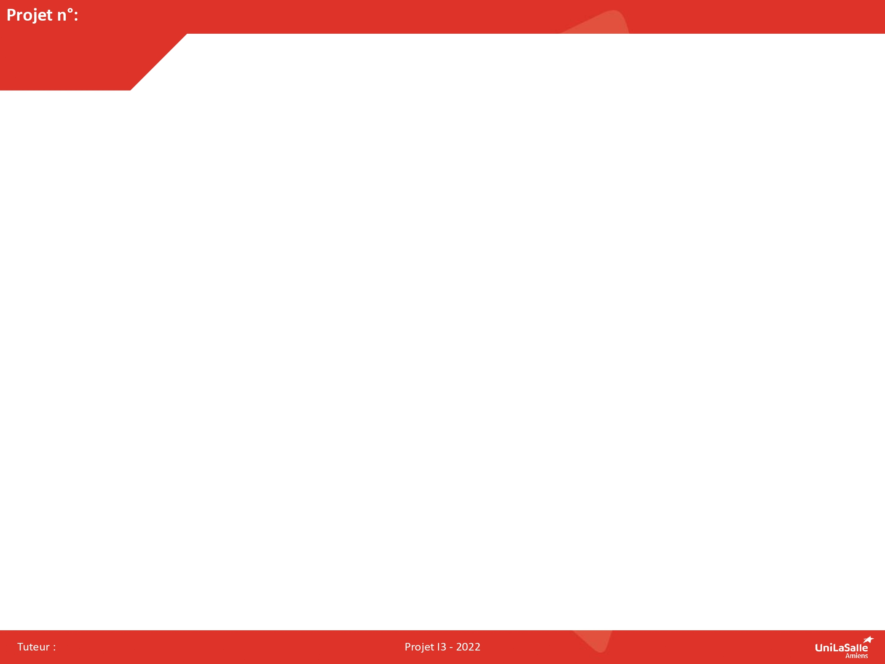

# RetroCore
# 🎮 RetroCore — Console portable rétro

RetroCore est un projet de conception et de réalisation d'une console de jeu portable inspirée des célèbres consoles rétro de type Game Boy.

L'objectif est de concevoir une console fonctionnelle en intégrant différentes compétences en mécanique, électronique et programmation embarquée.

Le projet comprend la conception du boîtier en CAO, l'intégration des composants électroniques (microcontrôleur, écran, joystick et boutons), ainsi que le développement du logiciel permettant de gérer les interactions et les jeux.

Destinée aux amateurs de jeux vidéo rétro et aux passionnés de technologie, RetroCore a pour ambition de proposer une console compacte, interactive et entièrement réalisée par notre équipe.

---

💻 Code à mettre

📐 projet à mettre
## Le projet en 3D



{: .a_modifier }
> Exportez votre assemblage au format **GLB** (glTF binaire) depuis Onshape
> (clic droit sur l'onglet de l'assemblage > Exporter), placez-le dans `docs/assets/models/`,
> remplacez `Otto.glb` ci-dessus par le nom de votre fichier, puis supprimez `Otto.glb`.
> Gardez le fichier sous **25 Mo**.

## Poster

{: .a_modifier }
> Remplacez `docs/assets/images/poster.jpg` par votre poster (image de moins de **2 Mo**).

## Vidéo

<video src="assets/images/intro_amiens.mp4" controls title="Présentation du projet" style="width: 100%;"></video>

{: .a_modifier }
> Remplacez `docs/assets/images/intro_amiens.mp4` par votre vidéo :
> - 1 min 30 au format vertical ;
> - présentation du projet, fonctionnement, vues du prototype, conclusion ;
> - moins de **25 Mo** (exportez en 720p, par exemple avec HandBrake).
>
> Voir [Créer le poster et la vidéo de présentation](https://doc.makerspace-amiens.fr/workshops/methodologie-de-projet/tutorials/poster-video-presentation/).
