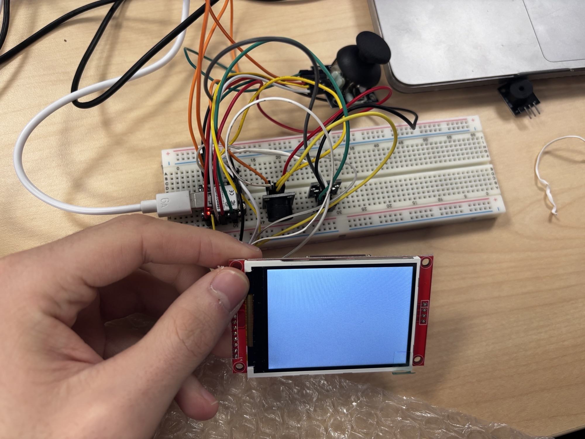

# Groupe 10

# 2026-11-24 : Fin des tests

**Séance :** planifiée · **Durée :** 1h30

## Actions effectuées


Lors de cette séance, nous avons poursuivi le développement de notre console **RetroCore** en réalisant plusieurs essais afin de faire fonctionner différents composants simultanément.

- Test de l'écran afin de vérifier son fonctionnement.
-  Normalisation du joystick pour obtenir des valeurs comprises entre -1 et 1.
- Assemblage et test de plusieurs composants simultanément.
- Développement d'un programme Arduino permettant de gérer le bouton, le buzzer et le joystick dans un même programme.
- Vérification de la lecture des axes X et Y ainsi que du bouton SELECT.

## 💻 Code d'assemblage des composants

```cpp
#include <Arduino.h>

constexpr int PIN_BUTTON = D5;
constexpr int PIN_BUZZER = D3;
constexpr int PIN_JOYSTICK_X = D0;
constexpr int PIN_JOYSTICK_Y = D1;
constexpr int PIN_JOYSTICK_SELECT = D2;

// Configuration bouton
constexpr int PRESSED_LEVEL = LOW;
constexpr unsigned long DEBOUNCE_MS = 30;

// Configuration buzzer
constexpr unsigned long BIP_DURATION = 100;
constexpr int BIP_FREQUENCY = 1000;

unsigned long bipStart = 0;
bool bipActive = false;

// Structure du bouton
struct Button {
    int pin;
    int stableLevel;
    int lastRead;
    unsigned long lastChangeMs;
};

// Initialisation du bouton
Button button = {
    PIN_BUTTON,
    HIGH,
    HIGH,
    0
};

// Détection d'un appui avec anti-rebond
bool justPressed(Button& b) {
    int level = digitalRead(b.pin);

    if (level != b.lastRead) {
        b.lastRead = level;
        b.lastChangeMs = millis();
    }

    if (millis() - b.lastChangeMs > DEBOUNCE_MS
        && level != b.stableLevel) {

        b.stableLevel = level;

        return level == PRESSED_LEVEL;
    }

    return false;
}

// Gestion du buzzer
void bip(bool trigger = false) {

    if (trigger && !bipActive) {
        tone(PIN_BUZZER, BIP_FREQUENCY);
        bipStart = millis();
        bipActive = true;
    }

    if (bipActive && millis() - bipStart >= BIP_DURATION) {
        noTone(PIN_BUZZER);
        bipActive = false;
    }
}

constexpr int JOYSTICK_DEADZONE = 300;
int joystickCenterX = 2048;
int joystickCenterY = 2048;

// Calibrage du joystick
void calibrateJoystick() {
    long sumX = 0;
    long sumY = 0;

    for (int i = 0; i < 16; i++) {
        sumX += analogRead(PIN_JOYSTICK_X);
        sumY += analogRead(PIN_JOYSTICK_Y);
        delay(2);
    }
}

// Normalisation des valeurs du joystick
float normalizeJoystick(int raw, int center) {
    int offset = raw - center;

    if (abs(offset) < JOYSTICK_DEADZONE) {
        return 0.0f;
    }

    int range = (offset > 0) ? (4095 - center) : center;

    return constrain((float)offset / range, -1.0f, 1.0f);
}

void setup() {
    Serial.begin(115200);

    pinMode(PIN_BUTTON, INPUT_PULLUP);
    pinMode(PIN_BUZZER, OUTPUT);

    pinMode(PIN_JOYSTICK_X, INPUT);
    pinMode(PIN_JOYSTICK_Y, INPUT);
    pinMode(PIN_JOYSTICK_SELECT, INPUT);
}

void loop() {

    if (justPressed(button)) {
        Serial.println("Bouton appuyé !");
        bip(true);
    }

    bip();

    float x = normalizeJoystick(
        analogRead(PIN_JOYSTICK_X), joystickCenterX
    );

    float y = normalizeJoystick(
        analogRead(PIN_JOYSTICK_Y), joystickCenterY
    );

    Serial.println(
        digitalRead(PIN_JOYSTICK_SELECT) == HIGH ? "HIGH" : "LOW"
    );

    Serial.print("> X : ");
    Serial.println(x);

    Serial.print("> Y : ");
    Serial.println(y);
}
```

## ⚙️ Fonctionnement du programme

Ce programme regroupe plusieurs composants de la console RetroCore afin de pouvoir les utiliser simultanément.

- 🕹️ **Joystick :** lecture des axes X et Y et transformation des valeurs brutes en valeurs comprises entre -1 et +1.
- 🎯 **Zone morte :** mise en place d'une zone morte de 300 afin d'éviter les petites variations involontaires du joystick.
- 🔘 **Bouton poussoir :** détection des appuis avec un système anti-rebond de 30 ms.
- 🔊 **Buzzer :** émission d'un bip de 1000 Hz pendant 100 ms lorsqu'un appui est détecté.
- 📟 **Moniteur série :** affichage des valeurs du joystick et de l'état du bouton SELECT.
- 🔧 **Assemblage :** regroupement de plusieurs fonctions dans un seul programme Arduino.

### 🎥 Image d'essai
</image>

## 🤔 Pourquoi ?

Cette séance avait pour objectif de commencer à regrouper les différents composants de la console RetroCore afin de vérifier leur fonctionnement ensemble.

La normalisation du joystick est une étape importante, car elle permet d'obtenir des valeurs plus faciles à exploiter dans la programmation des futurs jeux. Les valeurs comprises entre -1 et +1 pourront notamment servir à gérer les déplacements des personnages.

Le test simultané du bouton poussoir et du buzzer permet également de vérifier que plusieurs composants peuvent être gérés dans un même programme.

Ces essais nous permettent donc de progresser vers la création d'une console fonctionnelle, dans laquelle les différents éléments électroniques pourront communiquer et interagir entre eux.


## 🚀 Idées pour la prochaine séance

- 🖥️ Tester l'écran et vérifier son fonctionnement.
- 💻 Programmer l'écran afin de pouvoir afficher des informations.
- 🎨 Commencer à travailler sur l'affichage graphique de la console.
- 🔌 Réaliser le schéma de la carte électronique sur **KiCad**.
- ⚡ Préparer l'intégration des différents composants sur la future carte électronique.